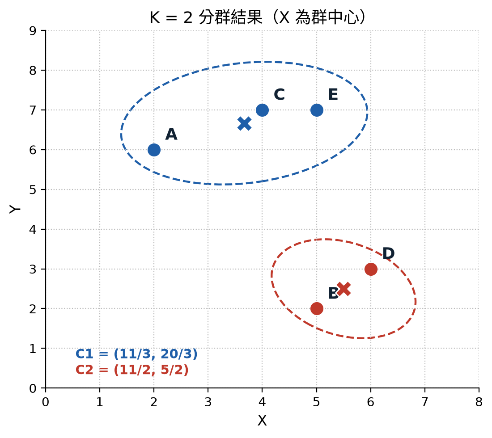
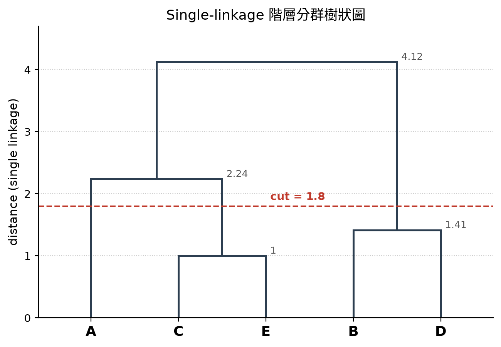
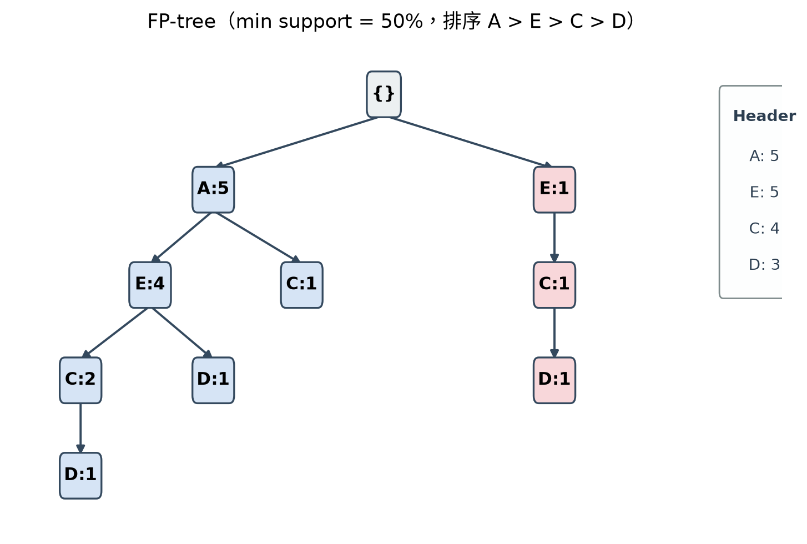

# 2026 資料科學導論 — 期中考（Quiz 2）

# 第一部分：題目

## 第 1 題 — 類神經網路與交叉驗證

**(a)** 可以簡單描述類神經網路中三層感知器 MLP 的基本架構？
*(Describing a mechanism of a multi-layer perception (MLP) of neural network (three layers)?)*

**(b)** 可以簡單描述 k-fold 交叉驗證概念及作法？
*(Describing conception and how to perform k-fold cross validation?)*

---

## 第 2 題 — K-means 與階層式分群

**(a)** 使用 K-means 分群技術將下列資料分成兩群（K=2）的結果為何，每一群集的中心座標為何？
*(Applying K-means clustering approach to cluster the following data to two clusters, and what are the center coordinates of the two clusters?)*

| Point | X | Y |
| :---: | :---: | :---: |
| A | 2 | 6 |
| B | 5 | 2 |
| C | 4 | 7 |
| D | 6 | 3 |
| E | 5 | 7 |

**(b)** 若使用最小距離（Single-linkage）的方式由下而上分群的階層架構樹為何？要分三群的切法為何？
*(Apply Single-linkage method to construct the corresponding hierarchical tree, and how to cut (what is the thresholding value) the tree to create a three clustered sub-groups?)*

---

## 第 3 題 — Naïve Bayes 分類器

如何使用 Naïve Bayes classifier 技術判斷下列表格的第七份文件（Test Data）是一份高興（h）的文件或是不高興（~h）的文件？
*(Using the following table data and Naïve Bayes classifier technique to describe the 7th document is a happy or non-happy document.)*

| # | 文件內容 (Document) | 類別 (Class) |
| :---: | --- | :---: |
| 1 | Love happy joy joy love | Yes (h) |
| 2 | Happy love kick joy happy joy | Yes (h) |
| 3 | Love move joy good | Yes (h) |
| 4 | Love happy joy pain love | Yes (h) |
| 5 | joy love pain kick pain | No (~h) |
| 6 | Pain pain love kick pain | No (~h) |
| **Test Data 7** | **Love pain kick** | **?** |

---

## 第 4 題 — 關聯規則與 FP-tree

某一商店當日顧客的購物內容資料如下資料表格所示，請分析符合最小支持度為 50%（minimum support rate >= 50%）和最小信度為 80%（minimum confidence rate >= 80%）的關聯規則為何（Finding all satisfied association rules）？如果有符合的關聯規則，請問該規則的增益度是多少（What are the associated Lift rate for found association rules）？畫出符合最小支持度為 50% 的 FP-tree（drawing the corresponding FP-tree with the minimum support rate >= 50%）。

| TID（交易編號） | 購物品項 (Item names) |
| :---: | :---: |
| 1 | A, C, D, E, F |
| 2 | A, C, E, G |
| 3 | A, B, D, E |
| 4 | C, D, E, H |
| 5 | A, E, F, G, I |
| 6 | A, B, C |

---

# 第二部分：解答（僅作為參考）
## 解答 1 — 類神經網路與交叉驗證

**(a)** MLP 的三層架構為：**輸入層（input layer）→ 隱藏層（hidden layer）→ 輸出層（output layer）**。
輸入層接收特徵，隱藏層以加權和加上激活函數（如 ReLU、sigmoid）做非線性轉換，輸出層給出預測結果，訓練時以倒傳遞（backpropagation）更新權重。

**(b)** k-fold 交叉驗證：把資料隨機切成 k 份（fold），每次取其中 1 份當測試集、其餘 k−1 份當訓練集，重複 k 次，最後將 k 次的評估結果取平均。
由於每次的測試集都不同，可比較不同切分方式／模型設定下的平均表現，找出最有效（泛化能力最好）的模型。

---

## 解答 2 — K-means 與階層式分群

**(a)** K = 2 的分群結果（假設初始中心落在 {A, C, E} 與 {B, D} 兩側）：

- 群 1：**{A, C, E}**，中心 = ((2+4+5)/3, (6+7+7)/3) = **(11/3, 20/3) ≈ (3.67, 6.67)**
- 群 2：**{B, D}**，中心 = ((5+6)/2, (2+3)/2) = **(11/2, 5/2) = (5.5, 2.5)**

**(b)** 單一連結（Single-linkage）以「兩群間最近的點對距離」合併，距離矩陣中最近的合併依序為：

| 順序 | 合併 | 高度（距離） |
| :---: | --- | :---: |
| 1 | C + E | 1.000 |
| 2 | B + D | √2 ≈ 1.414 |
| 3 | A + {C, E} | √5 ≈ 2.236（A–C 最近） |
| 4 | {A, C, E} + {B, D} | √17 ≈ 4.123（E–D 最近） |

要切成 **三群**，門檻值需落在 1.414 與 2.236 之間（例如 **1.8**），切線以下不再合併，得到
**{A}、{C, E}、{B, D}** 三群。

---

## 解答 3 — Naïve Bayes 分類器

以 6 筆訓練資料估計先驗機率與條件機率（文件中出現的詞：Love、Pain、Kick）：

| 機率 | h（Yes） | ~h（No） |
| --- | :---: | :---: |
| 先驗 P(class) | 4/6 | 2/6 |
| P(Love \| class) | 4/4 | 2/2 |
| P(Pain \| class) | 1/4 | 2/2 |
| P(Kick \| class) | 1/4 | 2/2 |

Test Data 7 = {Love, pain, kick}，在「各詞條件獨立」的假設下：

- P(h | x) ∝ P(h) · P(Love|h) · P(Pain|h) · P(Kick|h) = (4/6)(4/4)(1/4)(1/4) = **1/24 ≈ 0.042**
- P(~h | x) ∝ P(~h) · P(Love|~h) · P(Pain|~h) · P(Kick|~h) = (2/6)(2/2)(2/2)(2/2) = **2/6 = 1/3 ≈ 0.333**

因為 P(~h | x) > P(h | x)，第 7 份文件判為 **~h（不高興 / No）**。

---

## 解答 4 — 關聯規則與 FP-tree

**Step 1：計算 1-itemset 支持度**（min support = 50% × 6 = **3 筆**）

| Item | 出現交易 | Support | 是否頻繁 |
| :---: | --- | :---: | :---: |
| A | 1, 2, 3, 5, 6 | 5/6 | ✔ |
| C | 1, 2, 4, 6 | 4/6 | ✔ |
| D | 1, 3, 4 | 3/6 | ✔ |
| E | 1, 2, 3, 4, 5 | 5/6 | ✔ |
| B | 3, 6 | 2/6 | ✘ |
| F | 1, 5 | 2/6 | ✘ |
| G | 2, 5 | 2/6 | ✘ |
| H | 4 | 1/6 | ✘ |
| I | 5 | 1/6 | ✘ |

**Step 2：2-itemset 支持度**

| Itemset | 出現交易 | Support |
| --- | --- | :---: |
| {A, C} | 1, 2, 6 | 3/6 ✔ |
| {A, E} | 1, 2, 3, 5 | 4/6 ✔ |
| {C, E} | 1, 2, 4 | 3/6 ✔ |
| {D, E} | 1, 3, 4 | 3/6 ✔ |
| 其他組合 | — | ≤ 2/6 ✘ |

沒有任何 3-itemset 達到 3 筆，故最大頻繁項目集為 2-itemset。

**Step 3：產生關聯規則（min confidence = 80%）**

| 規則 | Support | Confidence | Lift | 結果 |
| --- | :---: | :---: | :---: | :---: |
| **A → E** | 4/6 | 4/5 = 80% | (4/6) / ((5/6)(5/6)) = **24/25 ≈ 0.96** | ✔ 符合 |
| **E → A** | 4/6 | 4/5 = 80% | (4/6) / ((5/6)(5/6)) = **24/25 ≈ 0.96** | ✔ 符合 |
| **D → E** | 3/6 | 3/3 = 100% | (3/6) / ((3/6)(5/6)) = **6/5 = 1.2** | ✔ 符合 |
| A → C | 3/6 | 3/5 = 60% | — | ✘ 信度不足 |
| C → A | 3/6 | 3/4 = 75% | — | ✘ 信度不足 |
| C → E | 3/6 | 3/4 = 75% | — | ✘ 信度不足 |
| E → C | 3/6 | 3/5 = 60% | — | ✘ 信度不足 |
| E → D | 3/6 | 3/5 = 60% | — | ✘ 信度不足 |

> **訂正**：原卷把 D → E 的增益寫成 (3/3) ÷ (3/6) = 2（紅筆打叉）。分母應為 E 的支持度 5/6，故正確值為 **6/5 = 1.2**；其餘兩條規則的 24/25 正確。
> 三條規則中只有 **D → E** 的增益大於 1，代表「買 D 會提升買 E 的機率」；A → E 與 E → A 的增益略小於 1。

**Step 4：FP-tree（min support = 50%，依支持度遞減排序 A(5) > E(5) > C(4) > D(3)）**

各筆交易重排後：

| TID | 排序後項目 |
| :---: | --- |
| 1 | A, E, C, D |
| 2 | A, E, C |
| 3 | A, E, D |
| 4 | E, C, D |
| 5 | A, E |
| 6 | A, C |

樹上節點標記為「項目:計數」，同一前綴路徑共用節點；右側 Header table 可用來串接同名節點的 node-link。

---

## 圖表清單

| 圖檔 | 內容 | 對應題目 |
| --- | --- | --- |
| `assets/fig1-kmeans-data.png` | K-means 範例資料點散佈圖 | 第 2 題 |
| `assets/fig2-kmeans-clusters.png` | K = 2 分群結果與群中心 | 解答 2 |
| `assets/fig3-dendrogram.png` | Single-linkage 階層樹與切線 | 解答 2 |
| `assets/fig4-fptree.png` | FP-tree 與 Header table | 解答 4 |
| `assets/diagrams.drawio` | 樹狀圖與 FP-tree 的可編輯 draw.io 原始檔（2 頁） | 解答 2、4 |

> `diagrams.drawio` 可用 [draw.io](https://app.diagrams.net) 開啟後自行調整線條、配色與節點，再匯出 PNG/SVG 覆蓋上面的圖檔。
